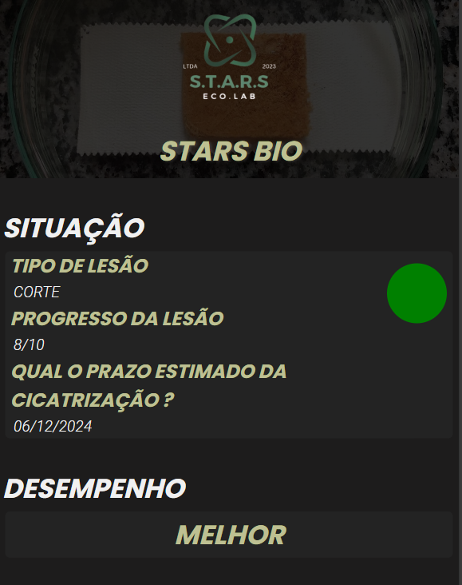

# 🩹 STARS BIO

Aplicativo desenvolvido em parceria interdisciplinar entre os cursos de **Tecnologia** e **Administração** da EEEP Leonel de Moura Brizola, com o objetivo de apresentar um protótipo funcional de acompanhamento para um biocurativo inteligente.

  

## 📌 Sobre o projeto

O STARS BIO simula o funcionamento de um aplicativo que acompanha o uso de um **biocurativo**, permitindo que o usuário registre e defina condições de saúde para monitoramento do processo de cicatrização.

## ✅ Funcionalidades

- Apresentação do produto (biocurativo) e sua proposta de valor
- Simulação do fluxo de uso do aplicativo
- Interface para o usuário definir condições/parâmetros de acompanhamento

## 🛠️ Tecnologias utilizadas

> HTML, CSS e JavaScript

## 👤 Minha contribuição

> Desenvolvi a interface de definição de condições do usuário e estruturei o front-end da aplicação

## 👥 Equipe

Projeto desenvolvido pela equipe **StarsBio**
📷 [Instagram do projeto](https://www.instagram.com/starsbio.s)

## 📝 Licença

Este projeto é de uso educacional, desenvolvido no contexto de uma parceria escolar entre os cursos de Tecnologia e Administração.
